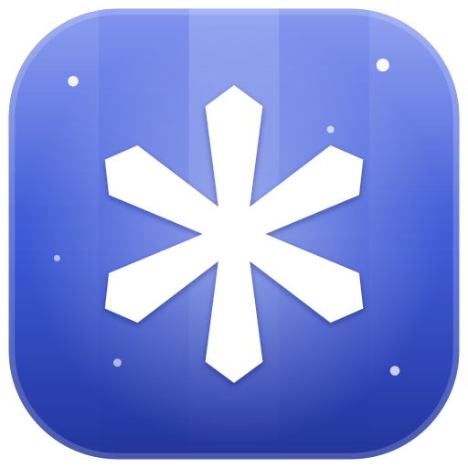
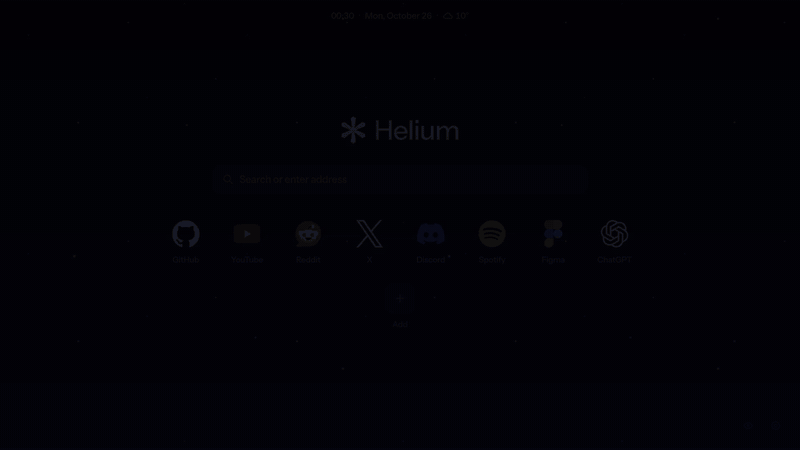
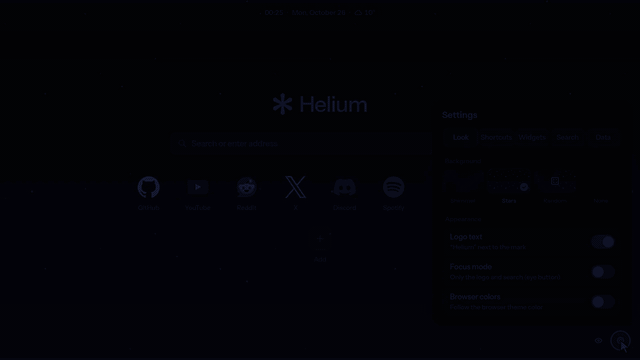
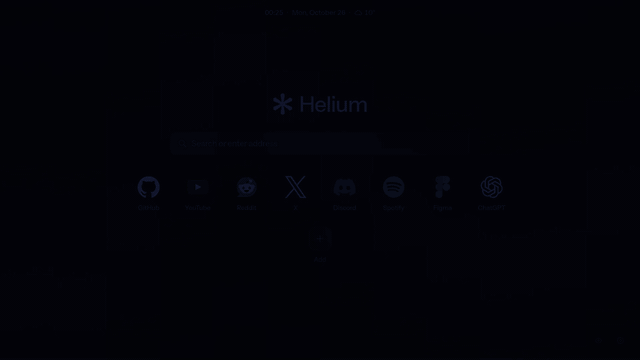
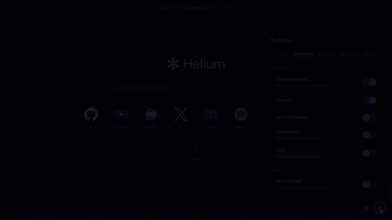
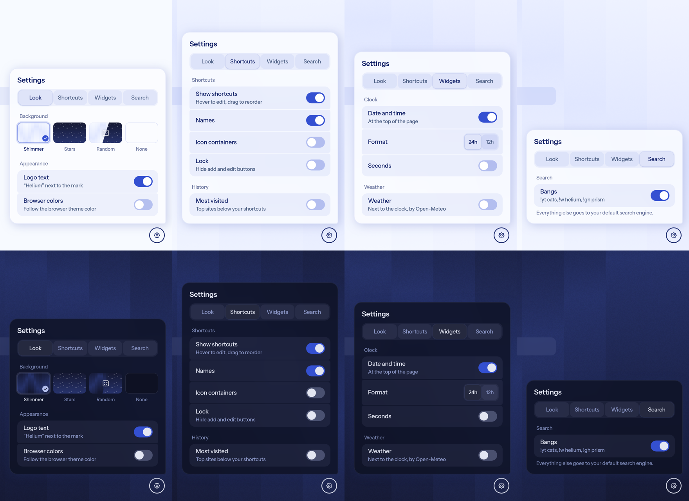

<p align="center">
    
</p>

<h1 align="center">Shimmer Tab for Helium</h1>

<p align="center">
    A new tab page for the <a href="https://helium.computer">Helium</a> browser, built with
    Helium's own UI kit, <a href="https://github.com/imputnet/helium-prism">Prism</a>.
</p>

<p align="center">
    
</p>

> Not affiliated with imput or the Helium project.

## Features

- **Wallpapers**: Prism's animated shimmer, a drifting starfield with cursor parallax,
  random or none. Switching flows one into the other (stars → shimmer: the stripes punch
  down from the top), and opening a tab on the starfield drops you out of hyperspace.
- **Search** with **bangs** (`!yt lofi`, `cats !w`) from Helium's own catalog, an
  autocomplete list as you type `!…`, and an omnibox-style service chip. Type anywhere on
  the page to start searching.
- **Shortcuts** with high-res icons: vector logos for ~600 popular services, the site's own
  app icons otherwise, optically sized so every logo looks the same size. Optional
  containers, single-color tinting, names on/off, lock, drag to reorder.
- **Most visited**, **date & time**, **weather** (Open-Meteo, with a details tooltip).
- **Focus mode**: just the logo and the search bar.
- **Browser colors**: follows the `BrowserThemeColor` policy color, expanded into a Material
  palette the way Chromium does it.
- Settings in Prism style with morphing tabs, light/dark themes, export/import as JSON.

### Wallpapers that flow into each other

<p align="center">
    
</p>

### Bangs with autocomplete

<p align="center">
    
</p>

### Icons: containers, one color, names

<p align="center">
    
</p>

### Settings, light and dark

<p align="center">
    
</p>

## Install

```sh
cd helium-newtab
pnpm install
pnpm build
```

Then open `helium://extensions`, turn on **Developer mode**, **Load unpacked** and pick
`helium-newtab/dist`.

For **Browser colors**, also enable **Allow access to file URLs** in the extension's details:
Chromium doesn't expose the theme to extensions, so the page reads the policy file from
`/etc/chromium/policies/{managed,recommended}/*.json`.

## How some of it works

**Icons**, best first:

1. Vector logos from [svgl](https://svgl.app) with light/dark variants
   (`public/svg-icons.json`, refresh with `pnpm icons:refresh`; aliases live in the script).
2. The site's own high-res icons: web app manifest, apple-touch-icon, SVG favicon, sized
   `<link rel="icon">`, rasterized to 192px.
3. A colored letter.

Each icon's artwork is measured on a canvas and scaled by area, so round, square and wide
logos read as the same size. Icons are cached in `chrome.storage.local`; reading other sites
needs the `<all_urls>` host permission.

**Bangs**: Helium's catalog (`services.helium.imput.net/bangs.json`) is bundled as
`public/bangs.json` and only loaded once a bang is typed; refresh with
`pnpm bangs:refresh`.

## Showcase clips

`scripts/record-clips.sh` drives a background Helium over the DevTools protocol and records
short 1080p60 clips of the page into `previews/clips/` (needs ffmpeg and a GPU).

## Credits

- [Helium Prism](https://github.com/imputnet/helium-prism) (GPL-3.0), the UI components
- Starfield after [ErrorZeros' Helium New Tab](https://github.com/ErrorZeros/Helium-New-Tab-by-ErrorZeros)
- Bang resolver from [exsesx/helium-new-tab](https://github.com/exsesx/helium-new-tab)
  (MIT, `licenses/helium-new-tab-MIT.txt`)
- Bang catalog © Kagi Search and imput (MIT, `licenses/bangs-MIT.txt`)
- Logos via [svgl](https://svgl.app); they're trademarks of their owners
- Weather by [Open-Meteo](https://open-meteo.com)

## License

GPL-3.0, since the extension bundles Helium Prism.
